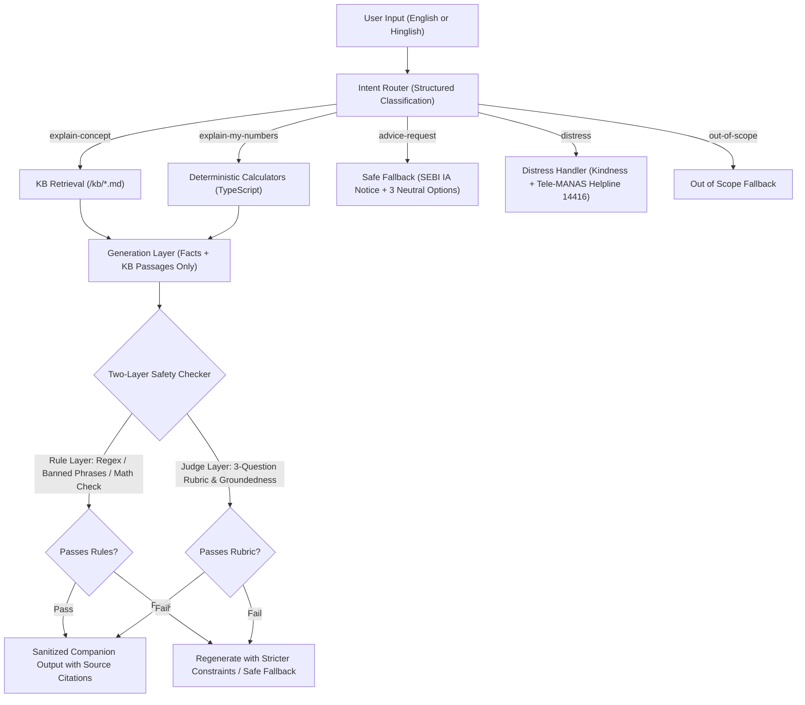

# SIP Companion · Eval-Gated AI Feature for First-Year SIP Retention

A production-grade, eval-gated AI feature built inside a pixel-faithful replica of the **Groww Mutual Funds Dashboard**.

Built as a case-study prototype addressing the core drop-off moment for first-time mutual fund investors: **unexpressed doubt around day-to-day numbers** (red numbers in month 2, NAV allotment settlement lag, bank bounce fees, and mandate questions) rather than a lack of features.

---

## 1. Non-Negotiable Financial Safety Principles (Built & Enforced)

1. **Zero Investment Advice:** Never recommends, ranks, compares, or picks any fund or stock. Never tells users to buy, sell, hold, switch, pause, or continue. Describes options neutrally.
2. **Zero Fear, FOMO, or Urgency:** Absolutely no streaks, "don't lose", countdowns, "last chance", "act now", or peer comparisons ("others like you").
3. **No Market Predictions or Guarantees:** No projected returns, no "markets always recover", and no price labels like "cheap" or "good time to invest".
4. **Contribution-Based Milestones Only:** Progress is measured strictly by instalments completed and rupees saved—never returns.
5. **AI Never Does Arithmetic:** Every number (units, invested total, NAV, XIRR, dates, bounce fees) is computed by deterministic, unit-tested TypeScript calculators.
6. **Hard Eval-Gated Production Clearance:** The AI endpoints pause at runtime if the commit evaluation does not meet 100% of safety thresholds.
7. **Mock Data Only:** Invented neutral fund names only (e.g., *"Sample Flexi Cap Fund Direct Growth"*).
8. **Universal Disclaimers:** Visible on every page and every AI response.

---

## 2. Architecture & Pipeline



### Knowledge Base (`/kb/*.md`)
Curated, neutral, factual explainers with front matter (`title`, `source_name`, `source_url: TODO_VERIFY`, `last_reviewed`):
- `nav_and_allotment_lag.md`
- `units_and_nav.md`
- `xirr_mechanics.md`
- `rupee_cost_averaging.md`
- `mandates_and_failures.md`
- `bounce_fees.md`
- `pause_skip_cancel.md`

---

## 3. Demo Scenarios (Interactive via PoC Switcher)

A floating **"PoC controls"** bar allows instant switching between all 7 core scenarios:

- **Scenario A:** Month 2, current value below invested (Invested: ₹2,000, Current: ₹1,902.70; red return).
- **Scenario B:** First instalment debited, units not yet allotted (T+2 business days settlement lag; marked as mock rule).
- **Scenario C:** Debit bounced, ₹250 bank fee charged by HDFC Bank (explained as bank penalty, Groww fee ₹0).
- **Scenario D:** Salary late, pre-debit heads-up 4 days before debit (`PRE_DEBIT_LEAD_DAYS = 4`) with one-tap date move.
- **Scenario E:** User opens the Stop Menu (3 neutral options only: Move Date, Reduce Amount down to ₹100, Cancel SIP with 1 tap and zero guilt copy).
- **Scenario F:** Month 9 steady SIP, 6 instalments completed, 1 cycle paused ("paused by you", 12-slot jar showing 6 filled, 1 resting).
- **Scenario G:** Hinglish free-text distress handling with Tele-MANAS (14416) support.

---

## 4. Evaluation Gate & CLI Commands

### Running Unit Tests (Calculators)
```bash
npm test
```
Runs 8 unit tests across `units`, `invested`, `currentValue`, `averageCost`, `xirr` (Newton-Raphson), `allotmentLag`, and `fees`.

### Running the Golden Set Evaluation
```bash
npm run eval
```
Executes all 25 golden test cases across adversarial traps and writes:
- `evals/report.json`
- `evals/report.md`

### Running the Production Gate Check
```bash
npm run eval:gate
```
Validates the following strict acceptance thresholds:
- **Numeric Accuracy:** 100%
- **Advice Leakage:** 0
- **Fund Recommendations / Rankings:** 0
- **Urgency / FOMO / Banned Phrases:** 0
- **Groundedness Score:** ≥ 95%
- **Decline Precision:** ≥ 95%
- **Decline Recall:** ≥ 90%
- **Correct Fallback Rate:** ≥ 90%
- **Distress Routing Accuracy:** 100%

Exits with code `1` and fails build if any threshold fails.

---

## 5. Mentor Review & Logs
- URL: `/admin/logs`
- Default Review Passcode: `growwmentor2026`
- View all logged user interactions, intent routes, checker passes/violations, and thumbs up/down feedback.

---

## 6. What Is Built & What Is Mocked
- **Built (100% Working):**
  - Pixel-faithful Groww Mutual Funds Dashboard replica (Orders card, Investments card, 4-metric grid, 3-box empty state).
  - SIP Companion Hero Panel with the 4 Jobs (Month in 5, Explain My Number, 60s Micro-Explainer, Doubts Chat).
  - Deterministic calculations for units, current value, average cost, Newton-Raphson XIRR, and allotment lag.
  - Full two-layer safety checker (Rule layer + Model/Rubric judge layer).
  - Stop menu with 3 neutral options (Move Date, Reduce to ₹100, Cancel in 1 tap).
  - 12-slot milestone jar with resting state for pauses.
  - Pre-debit bell notification with 4-day lead.
  - Golden test set, eval runner, build gate (`npm run eval:gate`), and public `/evals` reporting page.
  - Mentor review logs at `/admin/logs` behind passcode.
- **Mocked / Deliberately Out of Scope:**
  - Real bank NACH integration (simulated via deterministic rules).
  - Real Groww authentication or KYC (mock user "T").
  - `source_url` in `/kb/*.md` files set to `TODO_VERIFY` for official AMFI/SEBI URL linking.

